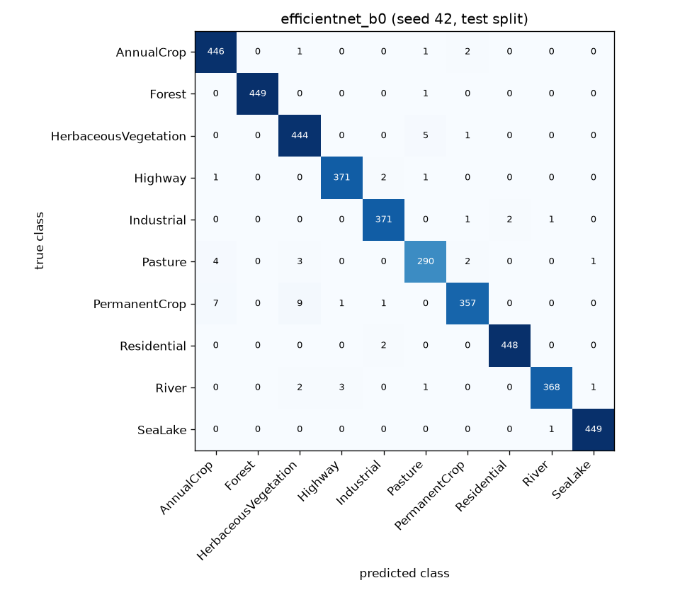
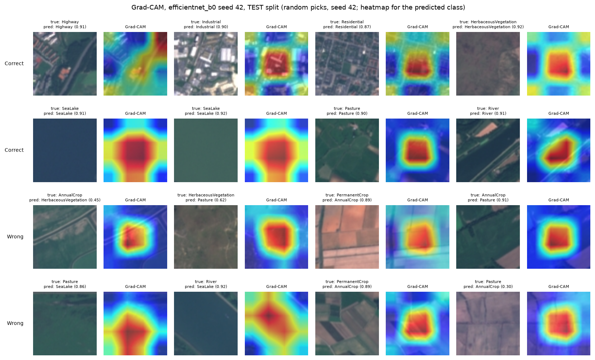
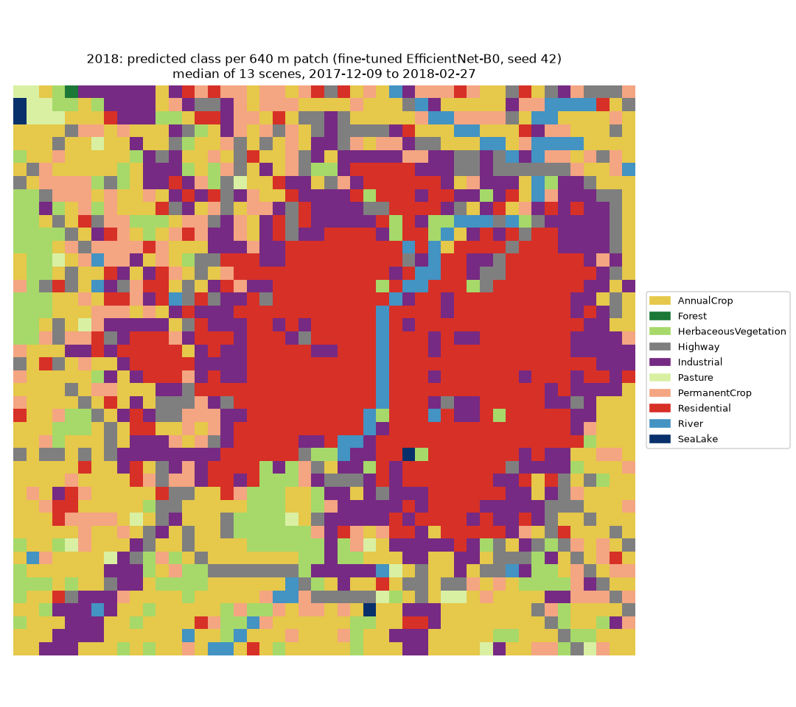
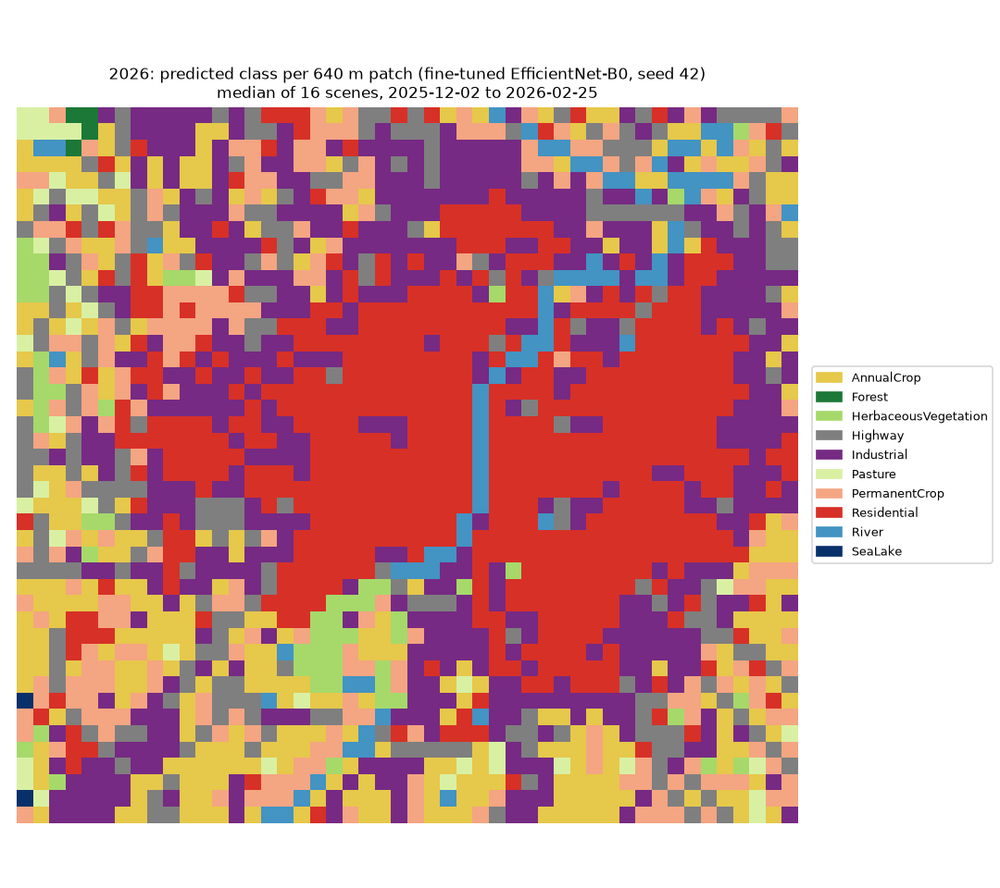

# TerraScan: does a land-use model trained on European satellite images work on Indian land?

A small research-style project on **domain shift** in satellite image classification. Models that read 64 × 64 px
Sentinel-2 patches (10 m per pixel, so 640 m × 640 m) were trained on the European EuroSAT dataset, then tested on
hand-labelled patches from Gujarat, India. A map website and a change study of Ahmedabad (2018 vs 2026) were built on top.

**Status: finished as a portfolio / learning project (wrapped up 2026-11-09). It is not a mapping product.** Read
[Known limitations](#known-limitations) before trusting any map.

- Live site: https://terrascan-five.vercel.app
- Model: https://huggingface.co/viranshul/terrascan-efficientnet-b0-india
- Indian dataset: https://huggingface.co/datasets/viranshul/terrascan-india-gujarat

## The question and the short answer

**Question:** if a land-use classifier is very accurate on European images, how accurate is it on Indian land, and how much
does a small set of local labels help?

**Short answer** (EfficientNet-B0, mean ± std over training seeds 42, 43, 44; sources in the tables below):

- On EuroSAT's own test images: **0.9869 ± 0.0013** accuracy (`results/india_after.json`; the same model family is in the EuroSAT table below).
- On Indian test patches it never saw: **0.4486 ± 0.0071** (about 45%).
- After fine-tuning on 149 Indian patches (mixed with some EuroSAT images): **0.6831 ± 0.0311**
  (about 68%; `results/india_after.json`). The ranges do not overlap, so the gain of
  23.5 percentage points is probably real, but it is still wrong on roughly 32% of the Indian test patches.
- The Indian test set is **tiny: 81 patches** from two areas (vadodara_outskirts, sanand_farmland), so every Indian number has a wide
  uncertainty range. These two areas were scored in the study steps (before and after fine-tuning); settings were chosen on
  the fine-tune areas and EuroSAT validation images, not on them (this rests on the project log; the code and results
  were committed together, so git history cannot prove the order).
- Change study, Ahmedabad 2018 vs 2026: the model reported **319 km²** of changed land use, but a check of
  50 random "changed" squares found only **51%** were real change (95% range 37%-65%), so
  the likely real change is about **163 km²** (95% range 119-207 km²). Source: `results/change_check.json`.

## What was done

1. **EuroSAT.** 27,000 RGB images (64 × 64 px, 10 classes), split 70 / 15 / 15 once and reused by every model
   (`data/splits/`). Five models, one shared training recipe (AdamW, cosine learning rate, label smoothing 0.1,
   50 epochs, keep the lowest-validation-loss epoch), 3 seeds each: a small CNN, ResNet-18 and EfficientNet-B0 started
   from ImageNet, and ResNet-18 started from Sentinel-2 satellite weights (torchgeo).
2. **Indian data.** Sentinel-2 L2A scenes (Microsoft Planetary Computer) from five ~10 km areas in Gujarat, Jan-Feb 2026,
   cut into the same 64 × 64 patches. EuroSAT was made from Level-1C images and these are Level-2A, so colours were
   matched to EuroSAT with a straight-line fit made on three **European** scenes only (`results/imagery_calibration.json`).
   368 patches were looked at, 230 got a label and 138 were skipped (hazy, mixed, or land that fits no
   EuroSAT class). The split is **by area**: fine-tune areas (ahmedabad_city, narmada_bharuch, ankleshwar_industrial) and test areas (vadodara_outskirts, sanand_farmland).
3. **Fine-tuning.** Start from the EuroSAT model, train all layers for 10 epochs (learning rate 0.0001, batch 32) on the
   fine-tune areas, mixed with 600 fresh EuroSAT images per epoch. No tuning on the test areas; the last epoch is kept.
4. **Change study.** Median composites of the clear scenes of one tile for Dec-Feb 2017/18 and Dec-Feb 2025/26, the
   fine-tuned model on 2112 patches, then a before/after check of a random sample of the "changed" squares.
5. **Website, API and model files.** React + MapLibre site, a small FastAPI server, ONNX export, model on Hugging Face.

## Results

### EuroSAT (Europe, the "easy" case)

Test split = 15% of EuroSAT (4,050 images), used for final reporting only. Mean ± std over seeds 42/43/44 (sample std);
SmallCNN v1 is one seed. Source: `results/<model>.json` made by `src/evaluate.py`; full table in `results/comparison.md`.
CPU ms = model only, batch 1, 1 thread, on the training laptop.

| Model | Seeds | Input | Params | Test accuracy | Test macro-F1 | CPU ms/image |
|---|---|---|---|---|---|---|
| small_cnn_v1 | 42 | 64×64 | 175,626 | 0.9615 (1 seed) | 0.9604 (1 seed) | 2.1 (1 seed) |
| small_cnn_v2 | 42, 43, 44 | 64×64 | 1,311,050 | 0.9874 ± 0.0007 | 0.9870 ± 0.0007 | 11.8 ± 0.1 |
| resnet18 | 42, 43, 44 | 128×128 | 11,181,642 | 0.9854 ± 0.0002 | 0.9849 ± 0.0003 | 14.5 ± 0.0 |
| efficientnet_b0 | 42, 43, 44 | 128×128 | 4,020,358 | 0.9869 ± 0.0013 | 0.9862 ± 0.0014 | 7.6 ± 0.1 |
| resnet18_sat | 42, 43, 44 | 128×128 | 11,181,642 | 0.9852 ± 0.0011 | 0.9848 ± 0.0011 | 14.3 ± 0.1 |

The multi-seed models score between 98.52% and 98.74%. The highest mean is small_cnn_v2 (0.9874 ± 0.0007); the
ranges of efficientnet_b0 overlap with it, so those are **about the same** and no model is claimed to beat another.
This is **consistent with published results**: the EuroSAT authors report 98.57% overall accuracy
([their page](https://github.com/phelber/EuroSAT), checked 2026-11-09). It is not a comparison against the state of the art,
and the splits and training details differ from the paper.

Confusion matrix of EfficientNet-B0, seed 42 (the model that was later fine-tuned for India; picked by validation accuracy, not test):



Where it looks (Grad-CAM, 8 correct and 8 wrong test predictions picked at random, seed 42; `src/gradcam.py`):



### Europe to India (domain shift)

Indian test = 81 patches from vadodara_outskirts, sanand_farmland. Mean ± std over 3 seeds. Source: `results/india_after.json`.

| | Before fine-tuning (Europe only) | After fine-tuning |
|---|---|---|
| Indian test accuracy | 0.4486 ± 0.0071 | 0.6831 ± 0.0311 |
| Indian test macro-F1 (classes present only) | 0.3729 ± 0.0028 | 0.4749 ± 0.0126 |
| EuroSAT test accuracy (4050 images) | 0.9869 ± 0.0013 | 0.9828 ± 0.0006 |

- Indian accuracy rose by 23.5 percentage points; EuroSAT accuracy fell by 0.4 points (small, but the ranges do not overlap).
- A first try that fine-tuned on Indian patches only made the model **forget Europe**: EuroSAT validation accuracy fell to
  between 0.64 and 0.77 (`models/efficientnet_b0_india_nomix/`). Mixing EuroSAT images into every epoch fixed it.
- Patches that fit no EuroSAT class were left out of the Indian data, so the test set is easier than "any Indian land".

### Change in Ahmedabad, 2018 to 2026




The maps over-report change: only 51% of the sampled "changed" squares showed a real change; the rest were the model changing its mind, not the land.
Numbers are in the short answer above (`results/change_check.json`).
The check was done by eye on before/after image pairs (one reviewer; 6 of the 50 answers were changed on review), so it is a judgement, not ground truth.

### What went wrong on the way

- With early stopping at patience 15, EfficientNet-B0 stopped 2 of 3 seeds early (after 23 and 18 epochs; best epochs 8 and 3) while the learning
  rate was still high, so the final recipe always trains 50 epochs and keeps the best epoch (`models/efficientnet_b0_patience15/*/metrics.json`).
- With plain Level-2A colours, a European control scene came out much less blue than EuroSAT. The colour fit above fixed that
  before any Indian number was measured (`results/imagery_check.json`).
- Fine-tuning on Indian patches only caused forgetting (above).

## Known limitations

These are things seen on the live site and confirmed (or not) by an error audit of the fine-tune areas
(`results/error_audit.md`, 149 labelled patches, models that never saw the held-out area).

- **The Sabarmati river is sometimes predicted as crop.** It was seen on the live Ahmedabad map. The audit could reproduce it only
  rarely: of the 29 map squares that ESA WorldCover marks as water (at least 20% of the square), 22 came out as
  River and 1 as AnnualCrop; the rest were other classes. The river is narrower than a 640 m square, so the squares along it mix water with bridges and
  buildings (looked at by eye in the audit).
- **Residential areas are sometimes predicted as industrial, and the other way round.** On the live map, 165 of
  681 squares that WorldCover marks as built-up were called Industrial (24%). In the audit, 17 of 195 Residential
  patch-predictions became Industrial and 14 of 33 Industrial ones became Residential (patch-predictions = patches × 3 seeds).
- **Wide muddy rivers are called lakes.** Most River labels are on the Narmada at Bharuch, and they are usually predicted as SeaLake: only 3 of 24 River
  patch-predictions were right, 12 were SeaLake. There are no SeaLake labels in the Indian data at all.
- **Crops look different.** An EuroSAT-only model got 1 of 150 Indian AnnualCrop patch-predictions right; fine-tuned models that
  never saw the area got 71.

**Why.** These mistakes come from training on **European** data and a **small Indian dataset**. The audit ranks the causes
as: (1) EuroSAT's 10 classes do not fit Indian land well (wide muddy rivers, residential vs industrial, mixed patches),
(2) Indian crops look unlike EuroSAT's, (3) few and uneven local labels. These causes are the audit's evidence-based ranking,
not proof; the "winter crops" explanation for the crop colour gap is a guess and was not tested.

More limits:

- **Tiny Indian test set** (81 patches, two areas), 3 seeds, wide uncertainty. Do not compare it with other papers' numbers.
- **Narrow data:** 5 areas in one state, dry season, one scene per area. Nothing is known about other regions, the monsoon or other countries.
- **Labels are a judgement call.** Of the 230 Indian labels, an AI assistant suggested the first label for 187 patches (blind to the model's
  predictions) and 43 were labelled by the project owner; the owner reviewed every patch and made every final call. One reviewer, no second opinion.
- **Change maps over-report** (see above), and the check itself was done by looking at image pairs, which is also a judgement.
- **Colour matching is approximate** (fitted on 3 European summer scenes).
- RGB only, one patch at a time, no time series and no cloud mask beyond choosing clear scenes.
- Not for decisions about land, property, safety or policy.

## What was not done

The plan had a second phase meant to improve Indian accuracy: more spectral bands, large noisy label sets from public land-cover
maps, a satellite foundation model and a multi-city evaluation. The project was wrapped up before it. Only the error audit above, a class-scheme check
(`results/class_scheme.md`: no evidence for merging classes, so the 10 EuroSAT classes were kept) and the data code for extra bands
were finished. A band comparison was started but not completed, so **no result from it is reported anywhere**. There are no multi-city results,
no label-efficiency curves, and no GIF of the Compare slider.

## Run it yourself

Python 3.12. On the training laptop (NVIDIA GPU) install the CUDA build of PyTorch first, then the pinned packages:

```
python -m venv .venv
.venv\Scripts\activate
pip install torch==2.14.1 torchvision==0.29.1 --index-url https://download.pytorch.org/whl/cu126
pip install -r requirements.txt
python scripts/download_eurosat.py          # EuroSAT RGB from Zenodo (MD5 checked)
python scripts/make_splits.py               # the fixed 70/15/15 split (already committed in data/splits/)
python scripts/compute_stats.py
python -m src.train --config configs/efficientnet_b0.yaml --seed 42 --fast-dev-run   # always first
python -m src.train --config configs/efficientnet_b0.yaml --seed 42
python -m src.evaluate --config configs/evaluate.yaml                                 # test split, results/<model>.json
python scripts/comparison_table.py                                                    # results/comparison.md
python scripts/india_patches.py --config configs/india.yaml                           # needs internet (Planetary Computer)
python -m src.india_eval --config configs/india_eval.yaml                             # before fine-tuning
python -m src.india_finetune --config configs/india_finetune.yaml                     # after fine-tuning
python -m src.readme --config configs/readme.yaml                                     # rebuild this README from results/
pytest && ruff check .
```

The Indian steps need `data/india/` (the patches and `labels_reviewed.csv`), which is git-ignored; the patches come from `scripts/india_patches.py` and the final labels
are published in the Hugging Face dataset (`metadata.csv`). These commands are taken from the scripts' own usage notes; the whole chain was not re-run on a clean machine for this README. The website is in `web/` (`npm ci`, `npm run dev`, `npm test`) and the API in `api/`.
Training runs write `models/<run_name>/seed<N>/` (weights, exact config, `metrics.json`); weights and imagery are git-ignored.
This README is generated: change `src/readme_template.md` and run `python -m src.readme`, not `README.md`.

## Licence and credits

Code: MIT (see `LICENSE`). Model files: Apache-2.0 (start weights: timm `efficientnet_b0.ra_in1k`, Apache-2.0). Indian dataset: CC BY 4.0.
EuroSAT: MIT licence, Helber et al. (2019), *EuroSAT: A Novel Dataset and Deep Learning Benchmark for Land Use and Land Cover Classification*.
Contains modified Copernicus Sentinel data 2017, 2018, 2025 and 2026. Land-cover reference used in the audit only: ESA WorldCover 2021.
