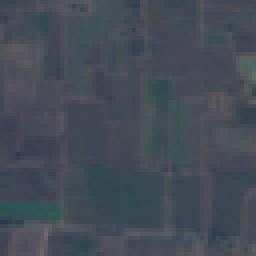
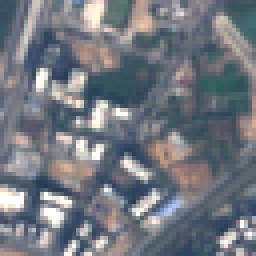
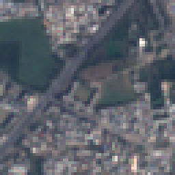
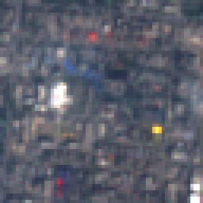
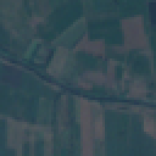
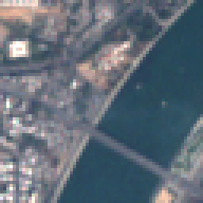
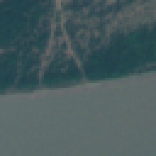
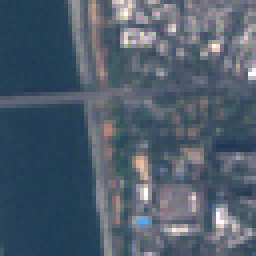

# Step 8.1: error audit on Indian land

Evidence only, no retraining to improve anything. Only the three Indian FINE-TUNE areas (ahmedabad_city, narmada_bharuch, ankleshwar_industrial; 149 labelled patches, labels = the user's `final_label`) are used for any claim of cause. The two TEST areas were scored in 4.3/4.4 and are not used here. Every number below comes from `results/error_audit.json`, built from `results/error_audit_predictions.csv` (by `src/error_audit.py`).

## 1. How wrong, and where

| model | accuracy (mean over seeds) | std | per seed |
|---|---|---|---|
| EuroSAT-only model (never saw these patches) | 0.4653 | 0.0495 | 42: 0.483, 43: 0.409, 44: 0.503 |
| Fine-tuned, leave-one-area-out (never saw the held-out area) | 0.6555 | 0.0169 | 42: 0.638, 43: 0.658, 44: 0.671 |

Per held-out area (mean ± std over seeds):

| model | ahmedabad_city | narmada_bharuch | ankleshwar_industrial |
|---|---|---|---|
| EuroSAT-only model (never saw these patches) | 0.736 ± 0.101 | 0.220 ± 0.025 | 0.448 ± 0.034 |
| Fine-tuned, leave-one-area-out (never saw the held-out area) | 0.862 ± 0.030 | 0.452 ± 0.058 | 0.678 ± 0.080 |

The TEST-area numbers for context only (not used for any claim here): `results/india_before.json` and `results/india_after.json`. The LOAO model is trained on only two areas, so it has fewer Indian patches than the 149-patch model of 4.4; its accuracy is not comparable to the 4.4 test number.

### Confusion matrix: EuroSAT-only model (never saw these patches)

Rows = true class (the user's label), columns = predicted. Counts add up the 3 seeds, so each patch is counted 3 times.

| true \ predicted | AnnualCrop | Forest | HerbaceousVegetation | Highway | Industrial | Pasture | PermanentCrop | Residential | River | SeaLake | total |
|---|---|---|---|---|---|---|---|---|---|---|---|
| AnnualCrop | 1 | 0 | 1 | 8 | 0 | 30 | 109 | 1 | 0 | 0 | 150 |
| Forest | 0 | 0 | 1 | 0 | 0 | 1 | 1 | 0 | 0 | 0 | 3 |
| HerbaceousVegetation | 0 | 0 | 3 | 0 | 0 | 0 | 0 | 0 | 0 | 0 | 3 |
| Highway | 0 | 0 | 0 | 24 | 1 | 0 | 8 | 0 | 0 | 0 | 33 |
| Industrial | 0 | 0 | 0 | 0 | 26 | 0 | 0 | 7 | 0 | 0 | 33 |
| Pasture | 0 | 0 | 0 | 0 | 0 | 0 | 0 | 0 | 0 | 0 | 0 |
| PermanentCrop | 0 | 0 | 0 | 0 | 1 | 0 | 5 | 0 | 0 | 0 | 6 |
| Residential | 0 | 0 | 0 | 0 | 49 | 0 | 0 | 146 | 0 | 0 | 195 |
| River | 1 | 2 | 0 | 1 | 4 | 0 | 0 | 1 | 3 | 12 | 24 |
| SeaLake | 0 | 0 | 0 | 0 | 0 | 0 | 0 | 0 | 0 | 0 | 0 |

Most frequent mistakes: AnnualCrop → PermanentCrop (109); Residential → Industrial (49); AnnualCrop → Pasture (30); River → SeaLake (12); AnnualCrop → Highway (8); Highway → PermanentCrop (8); Industrial → Residential (7); River → Industrial (4).

Share right per true class (patches × seeds): AnnualCrop 0.01 of 150; Forest 0.00 of 3; HerbaceousVegetation 1.00 of 3; Highway 0.73 of 33; Industrial 0.79 of 33; PermanentCrop 0.83 of 6; Residential 0.75 of 195; River 0.12 of 24.

### Confusion matrix: Fine-tuned, leave-one-area-out (never saw the held-out area)

Rows = true class (the user's label), columns = predicted. Counts add up the 3 seeds, so each patch is counted 3 times.

| true \ predicted | AnnualCrop | Forest | HerbaceousVegetation | Highway | Industrial | Pasture | PermanentCrop | Residential | River | SeaLake | total |
|---|---|---|---|---|---|---|---|---|---|---|---|
| AnnualCrop | 71 | 0 | 1 | 9 | 1 | 6 | 61 | 1 | 0 | 0 | 150 |
| Forest | 2 | 0 | 0 | 0 | 0 | 0 | 1 | 0 | 0 | 0 | 3 |
| HerbaceousVegetation | 0 | 0 | 3 | 0 | 0 | 0 | 0 | 0 | 0 | 0 | 3 |
| Highway | 1 | 0 | 0 | 23 | 1 | 0 | 8 | 0 | 0 | 0 | 33 |
| Industrial | 0 | 0 | 0 | 4 | 15 | 0 | 0 | 14 | 0 | 0 | 33 |
| Pasture | 0 | 0 | 0 | 0 | 0 | 0 | 0 | 0 | 0 | 0 | 0 |
| PermanentCrop | 6 | 0 | 0 | 0 | 0 | 0 | 0 | 0 | 0 | 0 | 6 |
| Residential | 0 | 0 | 0 | 0 | 17 | 0 | 0 | 178 | 0 | 0 | 195 |
| River | 3 | 2 | 0 | 1 | 1 | 0 | 0 | 2 | 3 | 12 | 24 |
| SeaLake | 0 | 0 | 0 | 0 | 0 | 0 | 0 | 0 | 0 | 0 | 0 |

Most frequent mistakes: AnnualCrop → PermanentCrop (61); Residential → Industrial (17); Industrial → Residential (14); River → SeaLake (12); AnnualCrop → Highway (9); Highway → PermanentCrop (8); AnnualCrop → Pasture (6); PermanentCrop → AnnualCrop (6).

Share right per true class (patches × seeds): AnnualCrop 0.47 of 150; Forest 0.00 of 3; HerbaceousVegetation 1.00 of 3; Highway 0.70 of 33; Industrial 0.45 of 33; PermanentCrop 0.00 of 6; Residential 0.91 of 195; River 0.12 of 24.

## 2. Failure cases (picked by the rule in `configs/error_audit.yaml`)

Model: LOAO, seed 42 (the held-out area's patch was never in its training). Pictures are the patches enlarged 4× (640 m × 640 m on the ground), files in `reports/error_audit/`.

| patch file | lat, lon | true label | LOAO predicted | confidence | EuroSAT-only predicted (conf.) | why listed |
|---|---|---|---|---|---|---|
| `narmada_bharuch_r0192_c0000.png` | 21.72988, 72.90191 | AnnualCrop | PermanentCrop | 0.86 | PermanentCrop (0.89) | top mistake AnnualCrop -> PermanentCrop |
| `ahmedabad_city_r0832_c0000.png` | 23.00207, 72.50270 | Residential | Industrial | 0.88 | Industrial (0.90) | top mistake Residential -> Industrial |
| `narmada_bharuch_r0512_c0640.png` | 21.70175, 72.96416 | AnnualCrop | Highway | 0.91 | Highway (0.93) | top mistake AnnualCrop -> Highway |
| `ankleshwar_industrial_r0320_c0448.png` | 21.61878, 73.02569 | Industrial | Residential | 0.90 | Residential (0.89) | top mistake Industrial -> Residential |
| `narmada_bharuch_r0704_c0960.png` | 21.68480, 72.99532 | River | SeaLake | 0.91 | SeaLake (0.92) | top mistake River -> SeaLake |
| `narmada_bharuch_r1024_c0128.png` | 21.65491, 72.91536 | AnnualCrop | Pasture | 0.84 | Pasture (0.91) | top mistake AnnualCrop -> Pasture |
| `narmada_bharuch_r0832_c0256.png` | 21.67240, 72.92747 | River | SeaLake | 0.89 | SeaLake (0.92) | River patch called something else |
| `narmada_bharuch_r0768_c0192.png` | 21.67810, 72.92121 | River | SeaLake | 0.88 | SeaLake (0.86) | River patch called something else |
| `narmada_bharuch_r0832_c0320.png` | 21.67248, 72.93366 | River | SeaLake | 0.83 | SeaLake (0.78) | River patch called something else |
| `narmada_bharuch_r0832_c0064.png` | 21.67217, 72.90893 | River | Forest | 0.53 | Forest (0.60) | River patch called something else |

### The Sabarmati report: every River-labelled patch

The user saw the Sabarmati river predicted as crop on the live site. All River labels in the fine-tune areas are below. Seeds right = out of 3. "Live site" = the class the deployed model (fine-tuned on all three fine-tune areas, so these patches were IN its training data) gives the nearest 2026 square of `web/public/data/ahmedabad/patches.csv`.

| patch file | area | lat, lon | EuroSAT-only, seed 42 | LOAO, seed 42 | live site 2026 |
|---|---|---|---|---|---|
| `narmada_bharuch_r0832_c0320.png` | narmada_bharuch | 21.67248, 72.93366 | SeaLake (0/3 right) | SeaLake (0/3 right) | - |
| `ahmedabad_city_r0256_c0768.png` | ahmedabad_city | 23.05522, 72.57664 | Residential (0/3 right) | Residential (0/3 right) | Industrial (0.85, 308 m away) |
| `narmada_bharuch_r0832_c0064.png` | narmada_bharuch | 21.67217, 72.90893 | Forest (1/3 right) | Forest (1/3 right) | - |
| `narmada_bharuch_r0832_c0256.png` | narmada_bharuch | 21.67240, 72.92747 | SeaLake (0/3 right) | SeaLake (0/3 right) | - |
| `narmada_bharuch_r0768_c0192.png` | narmada_bharuch | 21.67810, 72.92121 | SeaLake (0/3 right) | SeaLake (0/3 right) | - |
| `narmada_bharuch_r0768_c0768.png` | narmada_bharuch | 21.67879, 72.97685 | River (2/3 right) | River (2/3 right) | - |
| `ahmedabad_city_r0576_c0768.png` | ahmedabad_city | 23.02634, 72.57716 | Industrial (0/3 right) | AnnualCrop (0/3 right) | River (0.94, 308 m away) |
| `narmada_bharuch_r0704_c0960.png` | narmada_bharuch | 21.68480, 72.99532 | SeaLake (0/3 right) | SeaLake (0/3 right) | - |

### The live site along the river and in the city (whole Ahmedabad map)

Only two Sabarmati patches carry a user label, so this uses ESA WorldCover (tier 2, a noisy reference, NOT ground truth) to find the squares of `web/public/data/ahmedabad/patches.csv` (2112 squares) that are at least 20% water or at least 50% built-up, and counts what the deployed model called them in 2026. The river is narrower than a 640 m square, so the water share is low; a first try at 50% water found only 1 square. The deployed model was fine-tuned on `ahmedabad_city`, so some of these squares are in its training data.

- WorldCover Permanent water bodies: 29 squares; live site says: River 22, Residential 2, HerbaceousVegetation 2, Pasture 1, AnnualCrop 1, Industrial 1.
- WorldCover Built-up: 681 squares; live site says: Residential 491, Industrial 165, Highway 20, River 4, HerbaceousVegetation 1.

## 3. Which classes occur in Gujarat?

User labels in the fine-tune areas:

| class | ahmedabad_city | narmada_bharuch | ankleshwar_industrial | fine-tune total |
|---|---|---|---|---|
| AnnualCrop | 0 | 39 | 11 | 50 |
| Forest | 0 | 1 | 0 | 1 |
| HerbaceousVegetation | 0 | 1 | 0 | 1 |
| Highway | 1 | 10 | 0 | 11 |
| Industrial | 2 | 0 | 9 | 11 |
| Pasture | 0 | 0 | 0 | 0 |
| PermanentCrop | 0 | 0 | 2 | 2 |
| Residential | 53 | 5 | 7 | 65 |
| River | 2 | 6 | 0 | 8 |
| SeaLake | 0 | 0 | 0 | 0 |

Totals over all 5 areas, for context (`results/india_labels.json`): AnnualCrop 75, Forest 5, HerbaceousVegetation 6, Highway 19, Industrial 17, Pasture 1, PermanentCrop 4, Residential 95, River 8, SeaLake 0.

ESA WorldCover 2021 (tier 2, a noisy reference, NOT ground truth), share of each fine-tune area box by pixels:

| WorldCover class | ahmedabad_city | narmada_bharuch | ankleshwar_industrial |
|---|---|---|---|
| Bare / sparse vegetation | 0.021 | 0.013 | 0.020 |
| Built-up | 0.771 | 0.116 | 0.283 |
| Cropland | 0.051 | 0.573 | 0.434 |
| Grassland | 0.013 | 0.061 | 0.109 |
| Herbaceous wetland | 0.000 | 0.000 | 0.000 |
| Permanent water bodies | 0.031 | 0.088 | 0.010 |
| Shrubland | 0.023 | 0.000 | 0.000 |
| Tree cover | 0.091 | 0.149 | 0.144 |

## 4. Brightness and colour: does our pipeline still differ from EuroSAT?

| set | mean red | mean green | mean blue | std red | std green | std blue |
|---|---|---|---|---|---|---|
| EuroSAT train (data/stats.json) | 0.344 | 0.380 | 0.408 | 0.203 | 0.137 | 0.116 |
| Indian fine-tune-area patches (all 768 cut) | 0.376 | 0.401 | 0.429 | 0.177 | 0.145 | 0.132 |
|   ahmedabad_city (272) | 0.495 | 0.507 | 0.538 | 0.190 | 0.155 | 0.131 |
|   ankleshwar_industrial (224) | 0.337 | 0.355 | 0.379 | 0.138 | 0.109 | 0.095 |
|   narmada_bharuch (272) | 0.290 | 0.333 | 0.360 | 0.120 | 0.088 | 0.076 |

Gap (Indian mean − EuroSAT mean) in EuroSAT standard deviations, red/green/blue: 0.16, 0.15, 0.18.

Same class, Indian vs a seeded EuroSAT train sample (mean per colour):

| class | n India | n EuroSAT | India R | India G | India B | EuroSAT R | EuroSAT G | EuroSAT B |
|---|---|---|---|---|---|---|---|---|
| AnnualCrop | 50 | 300 | 0.257 | 0.305 | 0.334 | 0.523 | 0.482 | 0.469 |
| Highway | 11 | 300 | 0.300 | 0.343 | 0.371 | 0.344 | 0.379 | 0.407 |
| Industrial | 11 | 300 | 0.384 | 0.390 | 0.425 | 0.482 | 0.491 | 0.528 |
| Residential | 65 | 300 | 0.493 | 0.503 | 0.533 | 0.399 | 0.411 | 0.447 |

EuroSAT-only model, seed 42: mean brightness (mean of the 3 colours, 0-1) of patches it got right 0.478 (n=72) vs wrong 0.338 (n=77).

## 5. Ranked likely causes

Written by Claude from the tables above; every number in it is filled in by code from `results/error_audit.json`. "Evidence" says what the files show; "Not tested" says what would still have to be checked. These are causes of errors on the three fine-tune areas only (the TEST areas are not used). No fix was tried in this step.

### What did and did not reproduce from the live site

- **"Sabarmati predicted as crop": mostly not reproduced.** In the live Ahmedabad map, 29 squares are at least 20% water by ESA WorldCover (tier 2); the live model calls 22 of them River and 1 AnnualCrop. Of the two user-labelled Sabarmati patches (both show the river, bridges and city on both banks), the held-out (LOAO, seed 42) model and the EuroSAT-only model (seed 42) say: `ahmedabad_city_r0256_c0768.png` LOAO Residential, EuroSAT-only Residential; `ahmedabad_city_r0576_c0768.png` LOAO AnnualCrop, EuroSAT-only Industrial. So the error exists for some river patches, but it is not what the live map does along most of the river. If you saw it somewhere specific, send me the place (the square's row/column or a screenshot) and I will look it up.
- **"Residential predicted as industrial": plausible, not measured by this check.** Of the 681 live squares that are at least 50% built-up by WorldCover, the live model says Residential 491, Industrial 165, Highway 20. WorldCover cannot say which squares are really industrial, so these counts alone do not prove errors; the labelled fine-tune patches do show the confusion, in both directions (below).
- **"City areas predicted as other classes": barely.** Only 5 of those 681 built-up squares are called something other than Residential, Industrial or Highway.

### Ranked causes

**1. The EuroSAT classes do not fit what Indian scenes contain at 10 m. (Strongest evidence.)**
- *Wide muddy rivers are called SeaLake.* The user labelled River 24 times (patch × seed rows); both models get only 3 (EuroSAT-only) and 3 (leave-one-area-out) right, and 12 of them are called SeaLake by both. Pictures of the Narmada patches (`narmada_bharuch_r0832_c0320.png`, `narmada_bharuch_r0704_c0960.png`) show a very wide, brown-grey estuary, not the blue water EuroSAT's SeaLake shows (my reading of the pictures). We have 0 SeaLake labels, so River versus SeaLake is a naming question as much as a model one.
- *Residential and Industrial are confused in both directions.* EuroSAT-only: Residential to Industrial 49, Industrial to Residential 7. After leave-one-area-out fine-tuning: 17 and 14. Pictures (`ahmedabad_city_r0832_c0000.png`, `ankleshwar_industrial_r0320_c0448.png`) show dense blocks that I could not label with confidence myself at this size.
- *A 640 m patch often holds several things* (river plus city on the Sabarmati patches), but gets one label.
- Not tested: whether merging classes helps (that is 8.2, with its own rule), and whether you can tell Residential from Industrial on a random sample.

**2. Indian crop fields look unlike EuroSAT's AnnualCrop. (Strong evidence for the pattern, the reason is a guess.)**
- EuroSAT-only gets 1 of 150 AnnualCrop patch × seed rows right; 109 are called PermanentCrop and 30 Pasture. Leave-one-area-out fine-tuning gets 71 of 150 right, from 11 to 50 crop patches in training (depending on the held-out area), so local examples fix about half of it quickly.
- Colour: same-class mean red is 0.257 for Indian AnnualCrop patches against 0.523 for a seeded EuroSAT sample, darker by 1.3 times EuroSAT's overall red standard deviation. Not tested: why. My guess from the pictures (dark green and brown tiled fields) is that these are winter-season crops in January to February; EuroSAT's capture dates are not known to me, so this stays a guess.

**3. Few and uneven local labels. (Strong evidence, and it limits every conclusion here.)**
- Fine-tune-area labels: AnnualCrop 50, Residential 65, Industrial 11, Highway 11, River 8, PermanentCrop 2, Forest 1, HerbaceousVegetation 1, Pasture 0, SeaLake 0.
- Leave-one-area-out accuracy swings by area: 0.862 for ahmedabad_city, 0.678 for ankleshwar_industrial, 0.452 for narmada_bharuch. Narmada loses most because the other two areas hold only 11 crop patches (`ankleshwar_industrial`) and 2 River labels (`ahmedabad_city`), so a class with so few local examples is hard to fix by fine-tuning. Rare-class rows in the matrices (3 to 6 patch × seed rows) mean very little.
- Overall: EuroSAT-only 0.465 ± 0.049, leave-one-area-out 0.655 ± 0.017 (mean ± std over seeds 42/43/44; the three seeds share the same patches, so this shows training noise only).

**4. Label and mixed-patch problems. (Weak evidence, one example.)**
- `narmada_bharuch_r0512_c0640.png` is labelled AnnualCrop but, to my eye, shows a town with a diagonal road (the held-out seed-42 model says Highway at 0.91 confidence). I did not change any label; please look at this patch yourself. Not measured: how many other labels are in doubt, since you reviewed every patch once and no second opinion exists.

**5. A global brightness or scaling error. (Unlikely to be the main cause.)**
- Overall the Indian fine-tune-area patches are only 0.16, 0.15 and 0.18 EuroSAT standard deviations (red, green, blue) off EuroSAT's mean. The per-class gaps point in opposite directions (crop darker, Residential brighter: mean red 0.493 against 0.399), so one colour correction cannot explain them. Areas differ from each other (mean red 0.495 in ahmedabad_city, 0.290 in narmada_bharuch), so brightness varies by place and scene, and one pipeline-wide correction would not fit all of them.
- Not tested: re-fitting the 4.1 calibration on Indian scenes, and the small JPEG-versus-PNG difference noted in step 4.3.

### What this means for the next steps

Causes 1 and 3 point at 8.2 (class scheme, using this evidence and its written rule) and 8.4 to 8.7 (more labels, including other cities). Cause 2 suggests more Indian crop examples help most per label, and 8.3 (more spectral bands) is where information beyond RGB could help tell crops, water and built-up apart. Cause 5 does not call for more calibration work.

