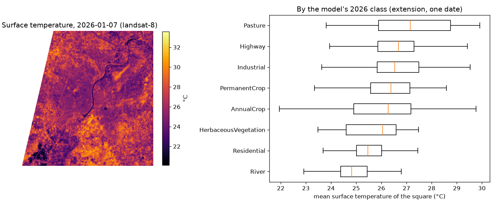

# Land-surface temperature vs land use, Ahmedabad (EXTENSION, step 8.9)

**This is an extension, not a main result.** Similar studies exist; nothing here is new.

Scene: `LC08_L2SP_148044_20260107_02_T1` (landsat-8, 2026-01-07, cloud 0.02%), band ST_B10 (Collection 2 Level-2 surface temperature). Squares used: 1677 of 2112 (at least 300 valid 30 m pixels). Classes: the model's 2026 map (`web/public/data/ahmedabad/patches.geojson`).

| Class | Squares | Median °C | Quartiles °C |
|---|---:|---:|---|
| River | 70 | 24.82 | 24.36 - 25.48 |
| Residential | 556 | 25.46 | 25.02 - 26.01 |
| HerbaceousVegetation | 34 | 26.06 | 24.53 - 26.66 |
| AnnualCrop | 215 | 26.27 | 24.88 - 27.18 |
| PermanentCrop | 154 | 26.39 | 25.57 - 27.14 |
| Industrial | 453 | 26.54 | 25.83 - 27.5 |
| Highway | 180 | 26.68 | 25.86 - 27.3 |
| Pasture | 15 | 27.15 | 25.88 - 29.41 |

## Limits

- one winter date, about 10:30 local time
- thermal band measured at 100 m, served at 30 m
- classes are model predictions, not ground truth
- a square's bounding box in UTM is used (slightly larger than the square)
- the scene's edge cuts off the west of the city, so not every square is used

Made by `src/lst.py` with `configs/lst.yaml`; numbers in `results/lst_ahmedabad.json`.
